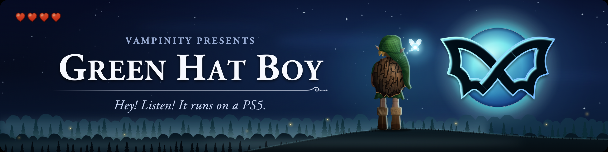
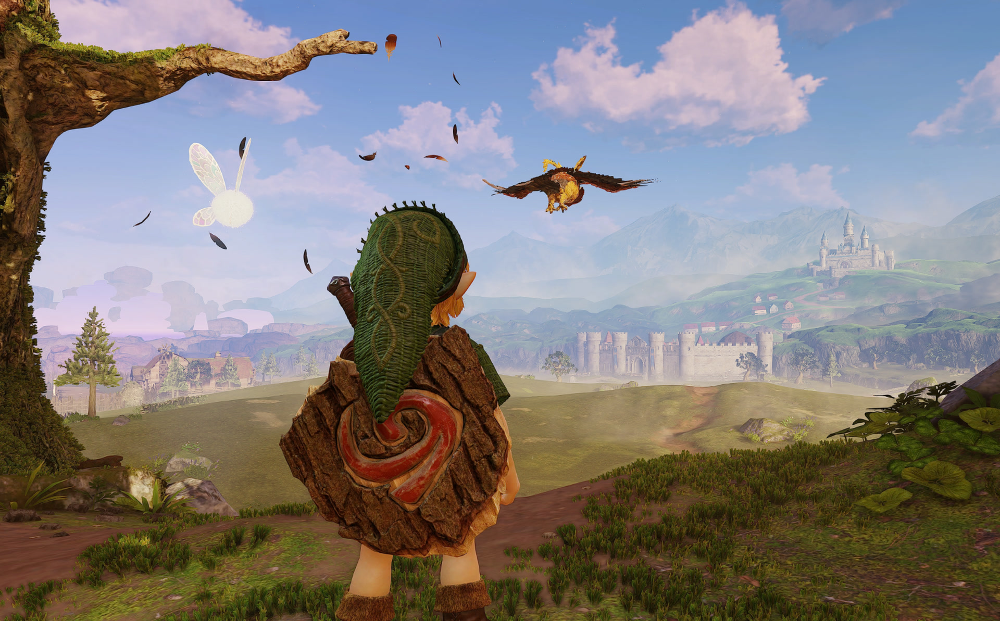
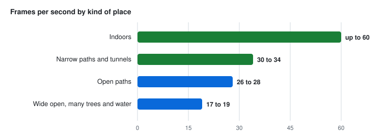

# Green Hat Boy

The Switch 2 version of Ocarina of Time on a jailbroken base PS5, through an emulator, at the game's full docked resolution. 
The aim is the whole game, start to finish, on a base PS5.

**Made by [Vampinity](https://github.com/Vampinity), together with [GrowingBlackBeans](https://github.com/GrowingBlackBeans) and [waveydude](https://github.com/waveydude)**

Built on [viejunerd's EglantinePS5 NUP build](https://github.com/viejunerd/Eglantine-PS5-), [heydemoura's EglantinePS5](https://github.com/heydemoura/EglantinePS5) and the [Eglantine](https://github.com/Djihads80/Eglantine) emulator core.

[Is there a download?](#is-there-a-download) · [What to expect](#what-to-expect-when-the-alpha-is-out) · [How fast](#how-fast-it-runs) · [What works](#what-works-what-is-fixed-what-is-being-improved) · [Talk and report](#where-to-talk-and-how-to-report-a-problem) · [Who makes this](#who-makes-this)

> [!IMPORTANT]
> **Unofficial and experimental. No game is included here, and none is linked.** This repository holds no game files, no keys and no firmware. You need your own copy of the game, dumped from your own console. Expect crashes and save often. Not affiliated with or endorsed by Nintendo, Sony, the Eglantine team or the Eden team; please send problems with these builds here, not to them. It is free, and it is not for sale.

  
   Leaving the forest, on a base PS5

## Is there a download?

**Not for newcomers yet.** The game starts, the opening plays and the first village is playable. But on a fresh install it still crashes on the way there, and we do not want your first try to end like that.

- The builds under [Releases](https://github.com/Vampinity/GreenHatBoy/releases) marked **Pre-release** are tester builds, for people who already help test and know the setup. Please do not start with those.
- **The first alpha** (an early test version) comes when a fresh install gets through its first start and into the first village without crashing on the way. We test exactly that on a real console, and the result goes on this page. No date until it passes.

## Progress so far

  <picture>
    <source media="(prefers-color-scheme: dark)" srcset="docs/img/progress-dark.svg">
    <source media="(prefers-color-scheme: light)" srcset="docs/img/progress.svg">
    
  </picture>

Each build is tried on a real console before it goes up.

## What to expect when the alpha is out

We would rather tell you now than have you find out on your own.

- **It can crash, most of all on the very first start.** On a fresh install the screen stays black for about half a minute after the opening movie. That is normal, so wait. The game can also crash in the first minutes after that.
- **If it crashes, start it again.** Each start gets further than the one before. If it keeps crashing at the same spot, tell us with the crash form (see below).
- **The game saves by itself, and often.** It does so as you walk and each time you go through a door. After a crash, choose Continue and you are back close to where you were. One thing to know: New Game overwrites that autosave. The game asks before it does.
- **Why a restart helps:** the first time you see a scene, the emulator has to build the small drawing programs for it. That takes time and memory. It keeps them on the PS5, so the next start can skip that work. For now the first start after an update counts as a first start too.
- **The opening stutters the first time you watch it**, and the sound can drop out for a moment. From the second start it plays nearly smooth.
- **Short freezes the first time you see a place**, about a second each. Walk the same way again and they are gone.
- **Wide open areas are the slow ones.** Indoors and on narrow paths it runs much faster; see [How fast it runs](#how-fast-it-runs).
- **Later in the game it can still crash when memory runs out.** That happens most in wide open areas and just after you move into a new one. Save before you move on.

## How fast it runs

**It depends on how much is on screen.** Closed-in places run fast. Wide open areas with many trees, water and other objects run slower.

  <picture>
    <source media="(prefers-color-scheme: dark)" srcset="docs/img/speed-by-place-dark.svg">
    <source media="(prefers-color-scheme: light)" srcset="docs/img/speed-by-place.svg">
    
  </picture>

Measured on 11 November on a base PS5, firmware 12.40, docked, full resolution, with the fast settings of that day, on test build T120. That was before the guard against jumping icons was added to the fast settings; the guard costs about 3%, so expect a little less now. The clean settings are a little slower: about 16 fps (frames per second) on the walk from Link's house into the village, against about 17 to 19 with the fast settings on the same walk. Wide open areas are where the speed work is going next.

## What works, what is fixed, what is being improved

**Works well, on a base PS5** (as of 12 November 2026)
- **Made for the base PS5 and tested on one every day** (firmware 12.40, and 13.60 on GrowingBlackBeans' and waveydude's consoles; waveydude also tries 9.40).
- **The game's full docked resolution.** Nothing is scaled down to gain speed.
- **A clean picture with the default settings**: no full-screen flashes, no white fog, and the leaves, ferns and grass are all drawn.
- **A ready-made PS5 app.** Copy it over and start; there is no PC build step and no Linux to boot.
- **Indoor areas and narrow paths**, at the speeds shown above.

**Fixed since the first test**
- The white fog over everything, and the bare trees: the forest looks as it should.
- Dark full-screen flashes in the default settings.
- **The black screen and crash on the very first start.** With two settings, 3 of 3 first starts got past it in our tests on 12 November, against 0 of 3 without. The two settings are not on by default yet.
- **The choppy movie behind the title screen.** Two settings cut the movie frames that were thrown away from over 650 to under 90, in both test starts on 12 November. They are not on by default yet either.
- **Icons and hearts jumping to the wrong place in the fast settings.** A guard removes that; standing in the village it costs about 3% speed.
- Freezes the first time a place is seen are shorter: about a second at most, where it was about four.
- The opening movies were badly out of sync. They are much better now, not perfect yet.

**Being improved right now**
- **The house and the house door on a fresh install.** This is what holds the alpha back. Our own console already has the village's graphics stored, and there a new game got through the door 10 times out of 10. On an empty install the game ran out of memory in the house on the first start and at the door on the second, in every test on the morning of 12 November. One of two third starts reached the village. The next round of fixes is being tested.
- **Crashes after long play.** We know the cause, and the fix is being tested.
- **Speed in wide open areas.** The more objects there are on screen, the slower it runs. The limit there is the emulator's own work for each object, not the PS5's graphics chip.
- **The opening the first time you watch it**: stutter, and a white flash on one camera cut.
- **A short stutter on the title screen** at the moment the logo comes up.

<b>For testers: how to install a tester build</b>

 

These steps are for people who help test. If you are new here, please wait for the alpha; it comes with a fuller guide.

**What you need**

| | |
|---|---|
| **A jailbroken PS5** | Base model, firmware 12.x or 13.x (tested on 12.40 and 13.60). PS5 Pro is not tested. This page does not explain jailbreaking. |
| **ShadowMountPlus 1.7beta4 or newer** | Runs with your jailbreak and puts homebrew apps on the home screen. |
| **A USB drive** | Formatted as exFAT, with room for the game (about 25 GB). FTP or a file manager app on the PS5 work too. |
| **Your own game, keys and firmware** | All dumped from your own Switch 2: the game as one `.nup` file, the `prod.keys` file and the firmware `.nca` files. None of these are included or linked, and this page does not explain how to dump them. |

**Steps**

1. **Download.** Open [Releases](https://github.com/Vampinity/GreenHatBoy/releases), take the newest tester build, and under **Assets** download the zip. Not "Source code".
2. **Unzip it.** Inside are a folder `PPSA98515` (the app), the settings files, `LICENSE` and the build's notes.
3. **Put it on the USB drive.** On the drive, make a folder called `homebrew` and put the whole `PPSA98515` folder in it. Then make a second folder for your own files, for example `eglantine`, with three folders inside it: `keys`, `firmware` and `roms`. Copy `prod.keys` into `keys`, all firmware `.nca` files into `firmware`, and your game's `.nup` file into `roms`.
4. **Plug the drive into the PS5** with your jailbreak running. A tile called **EglantinePS5** appears on the home screen. No tile? Restart the PS5 and run your jailbreak again.
5. **Tell the app where your files are.** Open EglantinePS5, go to **Settings > Game files**, browse to the `eglantine` folder on the USB drive and select it. Close the app and open it again.
6. **Play.** Open **Library**, pick the game and choose New Game. If the app says **Setup required**, a file from step 3 is missing or in the wrong folder.
7. **To stop,** save in the game first, then press **Touchpad + L1** together. Quitting this way also keeps the graphics the app prepared, so the next start is smoother.

The notes of each tester build say which settings file is for what, and what changed.

## Where to talk, and how to report a problem

**[Discussions](https://github.com/Vampinity/GreenHatBoy/discussions)** is the place for questions, your results and anything else.

**For a crash or a glitch**, open an [issue](https://github.com/Vampinity/GreenHatBoy/issues/new/choose) and pick a form: **Crash or glitch**, or **Send a run log**. The form asks for:

- Base PS5 or Pro, and your PS5 firmware (Settings > System > System Software > Console Information).
- Which build and which settings file you use.
- Where in the game it happened, and what you saw.
- For a crash: the newest `crash-*.txt` from `/data/eglantineps5/logs/` and the `crash-*-eden_log.txt` with the same time next to it. No crash file? Attach `/data/eglantineps5/user/log/eden_log.txt`.

> [!NOTE]
> A log attached to an issue is public. Before you attach one, delete the two lines that contain `EDEN_PAD_OPEN` and `EDEN_PAD_USERS` (they hold your console's user number) and anything with your own folder names in it. Or let the tool do it: `python3 tools/pack-run.py <folder with the log> --out .` removes them and packs the run.

### The log pool

Every test run of this project is kept in [`runs/`](runs/), one folder per run with the log, the settings and a short summary, and [`index.csv`](index.csv) lists them all, one row per run. If you test often and want to add your runs yourself, ask in Discussions; how to pack a run is in [`runs/README.md`](runs/README.md).

## Who makes this

Three of us are in this together: Vampinity, GrowingBlackBeans and waveydude.

### [Vampinity](https://github.com/Vampinity) · started and runs the project

Builds every version, tests it on a real base PS5 and writes the fixes that come out of that. From 5 to 12 November, in numbers (counted on the morning of 12 November):

| | |
|---:|---|
| **88 hours** | of PS5 time in automated test batches |
| **1,210** | test runs, in 340 batches |
| **71 hours** | of recorded picture checked frame by frame, about 15 million frames |
| **133** | test builds |
| **498** | patches in the newest build: own work and ports of other people's work |
| **515** | switches, own and ported, each tracked in a ledger with the runs that used it |

He built the test bench that runs by itself on a real PS5: it starts the game, plays a set walk, records the picture and checks every frame for flashes and stutter. With it he found what causes the flashes in the fast settings and built a guard against them, cut the short freezes in play from over 4 seconds to about 1, and proved the fix that took the dark flashes out of the default settings. On 12 November he found why a fresh install crashed on its very first start and got past that point with two settings, and made the movie behind the title screen play smoothly. He also measured what holds the wide open areas back and where the memory runs out, which is where the work goes next.

### [GrowingBlackBeans](https://github.com/GrowingBlackBeans) · collaborator

The project's second developer. Since 7 November, in numbers:

| | |
|---:|---|
| **148** | test runs on firmware 13.60, about 4 hours of play |
| **18** | patches on top of T120, one of them a port of a Lichii fix, all meant to be off unless their switch is set |
| **15** | dev builds of his own |

Among other things he wrote the fix that makes the fast settings possible, made each session build on the last one (on for everyone), found two freezes and the cause of the long hitches while walking, and wrote the log toolkit that reads every run here. He tests everything on firmware 13.60, which we cannot. A good part of how far this has come is thanks to him.

### [waveydude](https://github.com/waveydude) · collaborator

He started as a tester and now also writes fixes for the build. In numbers:

| | |
|---:|---|
| **6** | runs shared as full logs on 11 November: four sessions on 13.60, about 88 minutes in all, and two starts on 9.40 |
| **6** | commits of memory fixes, in every build since T113 |
| **3** | crash fixes from his own play, in T130 and later |

Most of his fixes are for memory and crashes: how the emulator's own memory store hands out large pieces, a graphics driver that asks for memory before it gives up, and the crashes that ended his own sessions. He tests on two base PS5s and plays much further into the game than our test routes go. His logs have pointed us to bugs of our own more than once.

### Built on the work of

[viejunerd](https://github.com/viejunerd), [heydemoura](https://github.com/heydemoura), the Eglantine and Eden teams, [Frizti](https://github.com/Frizti) (Fritchii), [zortos293](https://github.com/zortos293) and the Lichii contributors, [Duck912](https://github.com/Duck912), [mihawk-99](https://github.com/mihawk-99), exploitizm and notquiteog, among others.

Most of the new code is written with Claude. Who did what, in full: [CREDITS.md](CREDITS.md).

## Licence

GPL-3.0-or-later. See [LICENSE](LICENSE). The source of each build is published with it.

Nintendo Switch 2 and The Legend of Zelda: Ocarina of Time are trademarks of Nintendo. PlayStation and PS5 are trademarks of Sony Interactive Entertainment. They are named here only to say what this project runs and what it runs on. This project is not affiliated with or endorsed by Nintendo, Sony, the Eglantine team or the Eden team. No games, keys or firmware are included or linked.
