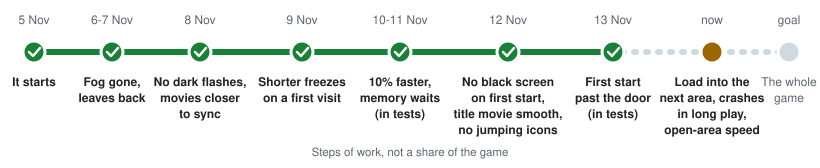

# Green Hat Boy

The Switch 2 version of Ocarina of Time on a jailbroken base PS5, through an emulator, at the game's full docked resolution. 
The aim is the whole game, start to finish, on a base PS5.

**Made by [Vampinity](https://github.com/Vampinity), together with [GrowingBlackBeans](https://github.com/GrowingBlackBeans)**

Built on [viejunerd's EglantinePS5 NUP build](https://github.com/viejunerd/Eglantine-PS5-), [heydemoura's EglantinePS5](https://github.com/heydemoura/EglantinePS5) and the [Eglantine](https://github.com/Djihads80/Eglantine) emulator core.

[What you need](#what-you-need) · [Install](#install-step-by-step) · [First time](#what-to-expect-the-first-time) · [How fast](#how-fast-it-runs) · [What works](#what-works-what-is-fixed-what-is-being-improved) · [Report a problem](#report-a-problem) · [Who makes this](#who-makes-this)

> [!IMPORTANT]
> **Unofficial and experimental. No game is included here, and none is linked.** The download holds no game files, no keys and no firmware. You need your own copy of the game, dumped from your own console. Expect crashes and save often. Not affiliated with or endorsed by Nintendo, Sony, the Eglantine team or the Eden team; please send problems with these builds here, not to them. It is free, and it is not for sale.

  
   Leaving the forest, on a base PS5

## Progress so far

  <picture>
    <source media="(prefers-color-scheme: dark)" srcset="docs/img/progress-dark.svg">
    <source media="(prefers-color-scheme: light)" srcset="docs/img/progress.svg">
    
  </picture>

Each build is tried on a real console before it goes up.

## What you need

| | |
|---|---|
| **A jailbroken PS5** | Base model, firmware 12.x or 13.x (tested on 12.40 and 13.60). PS5 Pro is not tested. This page does not explain jailbreaking. |
| **ShadowMountPlus 1.7beta4 or newer** | Runs with your jailbreak and puts homebrew apps on the home screen. |
| **A USB drive** | Formatted as exFAT, with room for the game (about 25 GB). FTP or a file manager app on the PS5 work too, see below. |
| **Your own game, keys and firmware** | All dumped from your own Switch 2: the game as one `.nup` file (about 25 GB, so leave room on the PS5), the `prod.keys` file and the firmware `.nca` files. None of these are included or linked, and this page does not explain how to dump them. |

## Install, step by step

About ten minutes, plus the time it takes to copy the game.

1. **Download.** Open [Releases](https://github.com/Vampinity/Eglantine-PS5-/releases), take the newest one, and under **Assets** download the zip whose name starts with `EglantinePS5-Ocarina`. Not "Source code".
2. **Unzip it.** Inside are a folder `PPSA98515` (the app), three settings files (`env-13x.txt`, `env-fast.txt`, `env-gbb-everyday.txt`), `LICENSE` and the build's notes.
3. **Firmware 13.x only.** Check on the PS5: Settings > System > System Software > Console Information. If the version starts with **13**: delete `env.txt` inside `PPSA98515`, copy `env-13x.txt` into `PPSA98515`, and rename it to `env.txt`. Make sure it does not become `env.txt.txt`. If it starts with **12**, skip this step.
4. **Put it on the USB drive.** On the drive, make a folder called `homebrew` and put the whole `PPSA98515` folder in it. Then make a second folder for your own files, for example `eglantine`, with three folders inside it: `keys`, `firmware` and `roms`. Copy:
   - `prod.keys` into `keys`
   - all firmware `.nca` files into `firmware`
   - your game's `.nup` file into `roms`
5. **Plug the drive into the PS5** with your jailbreak running. A tile called **EglantinePS5** appears on the home screen. No tile? Restart the PS5 and run your jailbreak again.
6. **Tell the app where your files are.** Open EglantinePS5, go to **Settings > Game files**, browse to the `eglantine` folder on the USB drive and select it. Close the app and open it again.
7. **Play.** Open **Library**, pick the game and choose New Game. Continue shows up once the opening has played. If the app says **Setup required**, a file from step 4 is missing or in the wrong folder. Fix it, then close and reopen the app.
8. **To stop,** save in the game first, then press **Touchpad + L1** together. The game ends and you are back in the app. Quitting this way also keeps the graphics the app prepared, so the next start is smoother.

**Rather keep it on the PS5 itself?** Copy the same folders with FTP or a file manager app: the app to `/data/homebrew/PPSA98515/` and your files to `/data/eglantineps5/` (`keys`, `firmware`, `roms`). Then you can skip step 6.

**Updating later:** download the new zip and copy its `PPSA98515` folder over the old one. This puts the 12.x `env.txt` back, so on 13.x, or if you use another settings file, do step 3 again before you copy. Your saves and your own files are kept outside that folder and stay. If the app itself offers an update, choose Skip: updates for this build come from this page.

### Which settings file?

The app only reads the `env.txt` inside its `PPSA98515` folder. To use another file, put it there under the name `env.txt`, the same way as in step 3.

| File | What it is | Firmware |
|---|---|---|
| `env.txt` (inside `PPSA98515`) | **Start here.** The clean picture. | 12.x |
| `env-13x.txt` | The same clean picture. | 13.x |
| `env-fast.txt` | Faster, but most sessions show a few wrong frames: short dark or bright flashes. Built on GrowingBlackBeans' frame race fix. | 12.x. On 13.x, open it in a text editor and change `EDEN_GUEST_SWAP_AHEAD_MIB=12288` to `EDEN_GUEST_SWAP_AHEAD_MIB=2048`. |
| `env-gbb-everyday.txt` | GrowingBlackBeans' own everyday settings: faster, one frame ahead, some wrong frames. | 13.x. On 12.x change `EDEN_GUEST_SWAP_AHEAD_MIB=2048` to `EDEN_GUEST_SWAP_AHEAD_MIB=12288`. |

## What to expect the first time

- **The title screen stutters for a moment** when the logo comes up, and the movie behind it is choppy. Harmless.
- **The opening movie after New Game** stays in step with its sound but drops some frames.
- **Continue is not there on your first start.** It shows up once the opening has played. From then on, if the game crashes before you have saved yourself, Continue takes you back in without watching the opening again.
- **Short freezes the first time you see a place**, about a second each. Walk the same way again and they are gone.
- **It gets smoother the more you play.** The app notes the graphics it has built and prepares them at the next start. It saves that list every 20 seconds, so even after a crash the next start is smoother than the first.
- **Wide open areas are the slow ones.** Indoors and on narrow paths it runs much faster; see [How fast it runs](#how-fast-it-runs).
- **It can crash when memory runs out.** That happens most in wide open areas and shortly after moving into a new one, and opening the pause menu there has triggered it. Save before you move to a new area. After a crash the app starts itself again and you can continue from your save.
- **The small text in the top-left corner** shows the frames per second. **Touchpad + R1** hides it.
- **If the app offers an update, choose Skip.** Updates for this build come from this page.

## How fast it runs

**It depends on how much is on screen.** Closed-in places run fast. Wide open areas with many trees, water and other objects run slower.

  <picture>
    <source media="(prefers-color-scheme: dark)" srcset="docs/img/speed-by-place-dark.svg">
    <source media="(prefers-color-scheme: light)" srcset="docs/img/speed-by-place.svg">
    
  </picture>

Measured on a base PS5, firmware 12.40, docked, full resolution, on the newest test build with `env-fast.txt` plus one extra line, `EDEN_UP_FRITCHII_USAGE_TRACKER=1`. Add that line to the file to match these numbers; without it, expect about 1 fps less. The clean settings are a little slower: about 16 fps on average on the walk from Link's house into the village, against about 17 to 19 with `env-fast.txt` on the same walk. Wide open areas are where the work is going now.

## What works, what is fixed, what is being improved

**Works well, on a base PS5** (as of 11 November 2026)
- **Made for the base PS5 and tested on one every day** (firmware 12.40, and 13.60 on GrowingBlackBeans' console).
- **The game's full docked resolution.** Nothing is scaled down to gain speed.
- **A clean picture with the default settings**: no full-screen flashes, no white fog, and the leaves, ferns and grass are all drawn.
- **A ready-made PS5 app.** Copy it over and start; there is no PC build step and no Linux to boot.
- **Indoor areas and narrow paths**, at the speeds shown above.

**Fixed since the first test**
- The white fog over everything, and the bare trees: the forest looks as it should.
- Dark full-screen flashes in the default settings.
- The opening movies were badly out of sync. They are much better now, not perfect yet.
- A crash on New Game on a base PS5 with firmware 12.x. Some testers on PS5 Pro and on 13.x still report one.
- Freezes the first time a place is seen are shorter: on the walk from Link's house into the village, about a second at most, where it was about four. New areas can still pause for a few seconds while they load.
- When memory runs short while it prepares graphics, it now waits instead of quitting at once. That is shown in tests; a real shortage can still end in a crash, see below.

**Being improved right now**
- **Speed in wide open areas.** The more objects there are on screen, the slower it runs. First measurements say the limit there is the emulator's own hand-over of each object to the graphics chip, not the chip itself. The work is on making that cheaper.
- **Memory when moving to a new area.** It can run out and end in a crash, sometimes after only a few minutes of play. Save before you move to a new area.
- **Glitches in the fast settings.** While you walk, icons can jump to the wrong place for a single frame, about 12 times a minute. A guard in the build removes that completely in our tests (0 in 3.5 minutes of walking against 41 without): add `EDEN_UP_AHEAD_GUARD=3` to `env-fast.txt`. It is not on by default yet, because it can make the second right after a door too bright; that is being fixed.
- **Small stutters on the title screen** when the logo comes up, and **the opening movie** after New Game is still slightly out of sync.
- **A crash some players see while the forest loads.** viejunerd's fix is in the build: add the line `EDEN_UP_SSBO_SIZE_CAP=1` to `env.txt` if you get that crash.

## Report a problem

Open an [issue](https://github.com/Vampinity/GreenHatBoy/issues/new/choose) and pick a form: **Crash or glitch**, or **Send a run log**. The form asks for:

- Base PS5 or Pro, and your firmware.
- Which settings file you use.
- Where in the game it happened, and what you saw. For a crash: did you open the pause menu shortly before?
- For a crash: attach the newest `crash-*.txt` from `/data/eglantineps5/logs/` and the `crash-*-eden_log.txt` with the same time next to it. No crash file? Attach `/data/eglantineps5/user/log/eden_log.txt`.

> [!NOTE]
> A log attached to an issue is public. Before you attach one, delete the two lines that contain `EDEN_PAD_OPEN` and `EDEN_PAD_USERS` (they hold your console's user number) and anything with your own folder names in it. Or let the tool do it: `python3 tools/pack-run.py <folder with the log> --out .` removes them and packs the run.

### The log pool

Every test run of this project is kept in [`runs/`](runs/), one folder per run with the log, the settings and a short summary, and [`index.csv`](index.csv) lists them all, one row per run. The format is GrowingBlackBeans' proposal. If you test often and want to add your runs yourself, ask for access in an issue; how to pack a run is in [`runs/README.md`](runs/README.md).

## Who makes this

### [Vampinity](https://github.com/Vampinity) · started and runs the project

Builds every version, tests it on a real base PS5 and writes the fixes that come out of that. The first week, 5 to 11 November, in numbers:

| | |
|---:|---|
| **67 hours** | of PS5 time in automated test batches |
| **988** | test runs, in 260 batches |
| **53 hours** | of recorded picture checked frame by frame, about 11 million frames |
| **122** | test builds |
| **463** | patches in the build: own work and ports of other people's work |
| **458** | switches, each tracked in a ledger with its runs and its verdict |

Among other things: a test bench that runs by itself on a real PS5, the cause of the flashes in the fast settings and a guard against them, and freezes cut from over 4 seconds to about 1.

### [GrowingBlackBeans](https://github.com/GrowingBlackBeans) · collaborator

The project's second developer. Among other things he wrote the fix that makes the fast settings possible, made each session build on the last one (on for everyone), found two freezes and the cause of the long hitches while walking, and tests everything on firmware 13.60, which we cannot. A good part of how far this has come is thanks to him.

### With fixes from [waveydude](https://github.com/waveydude)

The heap and driver memory fixes in the build, and test runs well past the first forest on his own base PS5.

### Built on the work of

[viejunerd](https://github.com/viejunerd), [heydemoura](https://github.com/heydemoura), the Eglantine and Eden teams, [Frizti](https://github.com/Frizti) (Fritchii), [zortos293](https://github.com/zortos293) and the Lichii contributors, [Duck912](https://github.com/Duck912), [mihawk-99](https://github.com/mihawk-99), exploitizm and notquiteog, among others.

Most of the new code is written with Claude. Who did what, in full: [CREDITS.md](CREDITS.md).

## Licence

GPL-3.0-or-later. See [LICENSE](LICENSE). The source of each build is published with it.

Nintendo Switch 2 and The Legend of Zelda: Ocarina of Time are trademarks of Nintendo. PlayStation and PS5 are trademarks of Sony Interactive Entertainment. They are named here only to say what this project runs and what it runs on. This project is not affiliated with or endorsed by Nintendo, Sony, the Eglantine team or the Eden team. No games, keys or firmware are included or linked.
