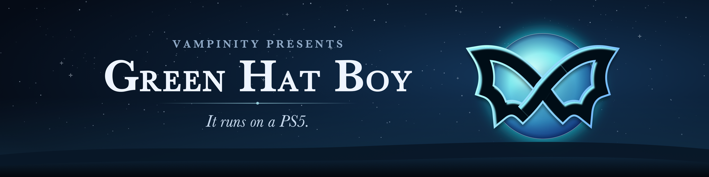
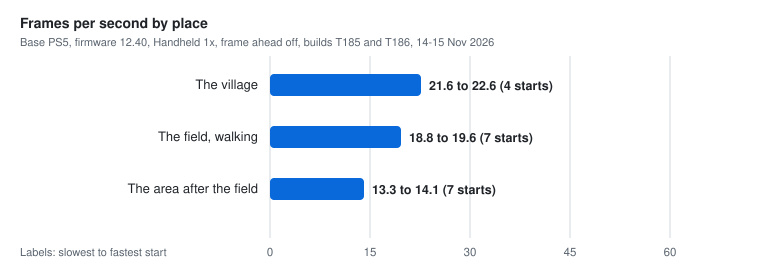

# Green Hat Boy

Emulator test builds, patches and test logs for a jailbroken base PS5. Bring your own game. 
This repository is emulator work and test logs. It is not the game and does not contain or link to it.

**Made by [Vampinity](https://github.com/Vampinity), together with [GrowingBlackBeans](https://github.com/GrowingBlackBeans) and [waveydude](https://github.com/waveydude)**

Built on [viejunerd's EglantinePS5 NUP build](https://github.com/viejunerd/Eglantine-PS5-), [heydemoura's EglantinePS5](https://github.com/heydemoura/EglantinePS5) and the [Eglantine](https://github.com/Djihads80/Eglantine) emulator core.

[Is there a download?](#is-there-a-download) · [What to expect](#what-to-expect-from-the-alpha) · [How to install](#how-to-install-the-alpha) · [How fast](#how-fast-it-runs) · [What works](#what-works-what-is-fixed-what-is-being-improved) · [Talk and report](#where-to-talk-and-how-to-report-a-problem) · [Who makes this](#who-makes-this)

> [!IMPORTANT]
> **Unofficial and experimental. No game is included here, and none is linked.** This repository holds no game files, no keys and no firmware. You need your own legally obtained copy of the game. Shader caches and saves are made on your own console and are never shared here. "Green Hat Boy" is this project's own name; it is not from or endorsed by the game's maker. Expect crashes and save often. Not affiliated with or endorsed by Nintendo, Sony, the Eglantine team or the Eden team; please send problems with these builds here, not to them. It is free, and it is not for sale.

## Is there a download?

**Yes: the first alpha**, an early test version. It is build T186 with play settings v4.0: **[alpha-t186 in Releases](https://github.com/Vampinity/GreenHatBoy/releases/tag/alpha-t186)**. How to put it on your PS5 is [below](#how-to-install-the-alpha). Please read [what to expect](#what-to-expect-from-the-alpha) first: it can still crash.

In short: on a base PS5 (firmware 12.40, handheld) it runs from the start through the village and the field. It can crash, and the area after the field is slow.

What it is tested on, and how far:
- **A base PS5 on firmware 12.40, in handheld at 1x.** That is the only setup tested with this build. Other firmware and the PS5 Pro are not tested with it, and docked is not ready yet.
- **The opening, the house and the village.** On a new game, 2 of 2 test starts that a script plays on a real console got through the opening and the house door into the village (build T185, shaders already built). For a fresh install, see the next point.
- **The field and the long loading pause into the area after the field.** In scripted starts from a save in the field, 15 of 15 got through that pause on builds T185 and T186 with these settings. The walk from the village out to the field was not part of these scripted tests. Played by hand on 15 November: about 2 hours from a save, with 3 crashes.
- **The very first start on a fresh install** (no shaders and no graphics driver cache prepared yet; a test save was on the console): 2 of 2 scripted first starts of the alpha's app got through the opening and the house door into the village on 15 November. Our bar for the alpha was that first start into the village. We had said something like 10 clean first starts in a row; this check ran 2.
- **The area after the field** runs, but slowly (about 14 fps). All three crashes by hand came at the loading pause into that area or inside it.

The older test build T180 in Releases is replaced by this alpha. It used frame ahead, which makes the ground and some objects flicker.

## Progress so far

  

The picture was made when 13 of the scripted starts through the long loading pause had run. It is 15 of 15 now, with about 18 to 34 seconds of black screen at that pause.

Each build is tried on a real console before it goes up.

## What to expect from the alpha

We would rather tell you now than have you find out on your own.

- **It can crash.** In about 2 hours of play by hand on 15 November it crashed 3 times: twice at the long loading pause between the field and the area after it, and once indoors in that area, a few minutes after the app was started. Each time the emulator had run out of free memory in one piece. Save often.
- **Before you go into a big new area: save, quit the app and start it again.** A fresh app start gives the memory back. Reloading a save inside the game does not: in one try in the village after the field, the largest free piece of memory stayed at 0 to 4 MiB after an in-game reload and was 700 to 840 MiB after a full restart, at the same spot.
- **The very first start prepares the graphics.** On a fresh install, expect a long black screen (up to about a minute in our check) and short stops the first time you see each place. In our check, 2 of 2 scripted first starts on a fresh install reached the village (a test save was on the console). If yours crashes, start it again: what the app already prepared is kept on the PS5, so the next start has less to do. For now the first start after an update counts as a first start too.
- **The long loading pause when you leave the field:** the screen stays black for about 18 to 34 seconds. That is normal, so wait.
- **Some plants, far trees and objects are missing until you swing the sword.** They appear when you do. We are working on it.
- **The game saves by itself, and often.** It does so as you walk and each time you go through a door. After a crash, choose Continue and you are back close to where you were. One thing to know: New Game overwrites that autosave. The game asks before it does.
- **The opening stutters the first time you watch it**, and the sound can drop out for a moment. From the second start it plays nearly smooth.
- **Short stops the first time you see a place**, about a second each. Walk the same way again and they are gone.
- **Now and then a wrong picture shows for a split second**, under a second in our test recordings.
- **It is slow outdoors.** About 21 to 22 fps in closed areas (indoors and the village), about 19 in open areas (walking across the field) and about 14 in open areas with many objects (the area after the field). Below 20 fps the game itself also runs a bit slower. Don't expect 30 outdoors on a base PS5; see [How fast it runs](#how-fast-it-runs).
- **Use handheld.** Docked gets through the long loading pause but then crawls for half a minute or more.

If it keeps crashing at the same spot, tell us with the crash form (see [below](#where-to-talk-and-how-to-report-a-problem)).

## How fast it runs

**It depends on how much is on screen.** Wide open areas with many trees, water and other objects run slower. In the chart, closed areas are indoors or walled in by trees, so you can't see far; open areas let you see far; many objects means a lot on screen at once.

  <picture>
    <source media="(prefers-color-scheme: dark)" srcset="docs/img/speed-by-place-dark.svg">
    <source media="(prefers-color-scheme: light)" srcset="docs/img/speed-by-place.svg">
    
  </picture>

Measured on 14 and 15 November in scripted starts with the alpha's play settings v4.0, on a base PS5, firmware 12.40, in handheld at 1x, with frame ahead off. The field and the area after the field are 7 starts each on T186, the alpha build. The village is 4 starts, standing in the village half a minute to a minute after arriving: 2 first starts of the alpha on a fresh install (T186) and 2 new-game starts on T185, the build before it. The label at each bar gives the slowest and the fastest start, in fps (frames per second); the bar ends at the fastest. Per start: the average in the village and on the scripted walk across the field up to the load, and the median from 70 seconds after the load in the area after the field.

The chart that was here until 15 November was measured with frame ahead on, docked, with the fast settings of that day and on other routes, so the two are not comparable one to one. Frame ahead is off now, because it makes the ground and some objects flicker. Below 20 fps the game itself also runs a bit slower. Don't expect 30 outdoors on a base PS5. Wide open areas are where the speed work is going next.

Docked with frame ahead off, 2 of 2 scripted starts on 15 November got through the load from the field, but then the screen stayed black for 44 to 55 seconds and the game ran under 1 fps for 29 to 47 seconds. That is why the alpha is for handheld for now.

## What works, what is fixed, what is being improved

**Works well, on a base PS5** (as of 15 November 2026)
- **Made for the base PS5 and tested on one every day** (firmware 12.40). GrowingBlackBeans and waveydude test their own builds on 13.60, and waveydude also on 9.40; the alpha build itself is tested on 12.40 only.
- **The game's own resolution, not scaled down to gain speed.** The alpha is tested in handheld at 1x. Handheld draws a smaller picture than docked, so it looks softer. Full docked resolution stays the goal; docked still crawls after the load from the field (see [How fast it runs](#how-fast-it-runs)).
- **A clean picture with the default settings**: no full-screen flashes and no white fog. Some plants, far trees and objects are still missing until you swing the sword (see below).
- **A ready-made PS5 app.** Copy it over and start; there is no PC build step and no Linux to boot.

**Fixed since the first test**
- The white fog over everything, and the bare trees: the forest looks as it should.
- Dark full-screen flashes in the default settings.
- **The black screen and crash on the very first start.** With two settings, 3 of 3 first starts got past it in our tests on 12 November, against 0 of 3 without. The two settings are in the alpha's play settings v4.0; the app's own defaults still leave them off.
- **The crash at the house door, from the second start on.** With the test settings, which build drawing programs on two threads instead of eight (on one in one test group), 16 of 16 second and third starts on a fresh install got through the door and into the village in our tests on 12 November. The two threads are in the alpha's play settings v4.0; the app's own defaults still use eight. For the very first start, see below.
- **The choppy movie behind the title screen.** Two settings cut the movie frames that were thrown away from over 650 to under 90, in both test starts on 12 November. They are in the alpha's play settings v4.0 too.
- **The ground losing its sunlight for a frame, and flags and cloth blinking.** Both come with frame ahead. With it off, 0 and 0 ground flashes at the field edge against 187 and 191 with it on, and 0 and 0 cloth blinks at a wall in the area after the field against 117 and 138 a minute, in two scripted starts each on 14 November (build T185, handheld, 1x). The default settings do not use frame ahead; play settings v3.9 did, and play settings v4.0, the alpha's settings, leave it out.
- **Icons and hearts jumping to the wrong place in the fast settings.** A guard removes that; standing in the village it costs about 3% speed.
- Short stops the first time a place is seen are shorter: about a second at most, where they were about four.
- The opening movies were badly out of sync. They are much better now, not perfect yet.

**Being improved right now**
- **The load from the field into the next area.** Played by hand on 13 November, every start crashed, the last three at this load. The alpha's settings (frame ahead off, plus a load window: the graphics side reads packed game memory straight through only while a load is going on, and the graphics driver keeps a small reserve for its own buffers) got through it in 15 of 15 scripted starts on builds T185 and T186 (handheld, 1x). The same settings without the load window got through 0 of 2, 2 of 2 and 3 of 4 in three rounds on 14 November. Played by hand on 15 November, in about 2 hours, this load crashed twice: once after about 20 minutes of play, once after about 55. Both times memory had run out (next item).
- **Crashes after long play.** In long play the emulator runs out of free memory in one piece. It is not the game's own memory that grows: in one session that stayed flat, while memory the emulator holds but cannot reuse grew from about 650 to about 930 MiB between minute 5 and minute 20. At the load from the field only 51 to 110 MiB was free in one piece; the load needs pieces of 100 to 300 MiB. That is why a full app restart helps and an in-game reload does not. We stand in for a long session by taking 512 MiB away before the load, but that leaves 457 to 574 MiB, so it is milder than real play. With `EDEN_UP_DRAIN_TO_POOL=1` added, 2 of 2 got through that stand-in in each of three batches on 14 and 15 November (builds T185 and T186); without it, 2 of 2, 1 of 2 and 1 of 2. The shorter crawl after the load that we saw on 14 November did not come back on 15 November. That line is not in the play settings. Build T190 (15 November) carries a fix candidate for one way the load can lock up while memory is short; the fix itself has not run on the console yet.
- **The very first start on a fresh install.** On 12 November it crashed at the house door about half the time (4 of 9 reached the village with the best settings). The cause turned out to be one graphics driver compile that took up to 909 MB; with a driver change it takes 78 to 89 MB, and 2 of 2 scripted first starts (build T144, docked, 1x) got through into the village on 13 November. The change is a setting, in the play settings since v3.9 and in the alpha's v4.0. On 14 and 15 November, with v4.0 and the shaders already built, 2 of 2 first starts on a new game got through the door into the village (build T185, handheld, 1x). On 15 November, from a fresh install with nothing prepared and a test save on the console, 2 of 2 scripted first starts of the alpha's app reached the village (build T186, handheld, 1x).
- **Missing plants, far trees and objects.** Near bushes, rows of far trees and some placed objects only show once Link swings the sword. One existing switch, `EDEN_NX2_NULL_SLOTS=2`, rebuilds two drawing programs that were translated with empty slots. With it, the far rows of trees stayed drawn while Link stood in the field, in 2 of 2 starts against 0 of 2 without (build T188). But they come out flat and sky blue, so the switch is not in the play settings yet.
- **Speed in wide open areas.** The more objects there are on screen, the slower it runs. The limit there is the emulator's own work for each object, not the PS5's graphics chip. In the area after the field (about 14 fps with frame ahead off, builds T185 and T186, handheld, 1x), the part of the emulator that reads the game's drawing commands spends about 18 ms a frame waiting for one small list of numbers that the graphics chip writes itself. That wait is what we work on next.
- **The opening the first time you watch it**: stutter, and a white flash on one camera cut.
- **A short stutter on the title screen** at the moment the logo comes up.

## How to install the alpha

**What you need**

| | |
|---|---|
| **A jailbroken PS5** | Base model. This build is tested on firmware 12.40 only; other firmware and the PS5 Pro are not tested with it. This page does not explain jailbreaking. |
| **ShadowMountPlus 1.7beta4 or newer** | Runs with your jailbreak and puts homebrew apps on the home screen. |
| **A USB drive** | Formatted as exFAT, with room for the game (about 25 GB). FTP or a file manager app on the PS5 work too. |
| **Your own game and files** | Your own legally obtained game and the files the app asks for, from your own console. None of these are included or linked here, and this page does not explain how to get them. |

**Steps**

1. **Get the alpha** from [alpha-t186 in Releases](https://github.com/Vampinity/GreenHatBoy/releases/tag/alpha-t186): download `GreenHatBoy-alpha-T186.zip`.
2. **Unzip it.** Inside are a folder `PPSA98515` (the app, with its settings file `env.txt` in it), `LICENSE` and `README-T186.txt` (what is in the build and its known problems).
3. **Put it on the USB drive.** On the drive, make a folder called `homebrew` and put the whole `PPSA98515` folder in it. If the drive already has a `homebrew` folder, open it and drag only `PPSA98515` into it. Do not drag a `homebrew` folder onto the drive: on a Mac that can replace the folder and delete the other apps inside it. Then make a second folder for your own files, for example `eglantine`, with three folders inside it: `keys`, `firmware` and `roms`. Put your own game in `roms`, and your other files in the folder the app names for each.
4. **Plug the drive into the PS5** with your jailbreak running. A tile called **EglantinePS5** appears on the home screen. No tile? Restart the PS5 and run your jailbreak again.
5. **Tell the app where your files are.** Open EglantinePS5, go to **Settings > Game files**, browse to the `eglantine` folder on the USB drive and select it. Close the app and open it again.
6. **Set Handheld at 1x.** That is how this build was tested. Docked is not ready yet.
   - **Handheld:** on the app's home screen, open **Library** and move to the game with Up or Down, but do not start it yet. The **Console mode** row shows Docked and Handheld. If Docked is lit (the default), press **Right** once. Handheld is now lit, and the app says "Saved for this game. Applies on next launch." It stays saved.
   - **1x:** then, on the home screen, open **Settings**, then **Video**. **Resolution** should say "1x (native)", which is the default. If it says something else, move to Resolution and press Left or Right until it says "1x (native)".
7. **Play.** In **Library**, start the game and choose New Game (or Continue). If the app says **Setup required**, a file from step 3 is missing or in the wrong folder. The very first start has a long black screen (up to about a minute in our check): wait.
8. **To stop,** save in the game first, then press **Touchpad + L1** together. Quitting this way also keeps the graphics the app prepared, so the next start is smoother.

**If the app offers an update, choose Skip.** It would replace this build with a different one.

**Firmware 13.x** is not tested with this build. If you try it, change `EDEN_GUEST_SWAP_AHEAD_MIB=12288` to `2048` in `env.txt`.

**Updating from an older build:** copy the old `PPSA98515` folder from `homebrew` on the drive to your computer. Then delete it from the drive and drag the new `PPSA98515` folder from the zip into `homebrew`. Keep the new `env.txt`. If you added lines of your own to the old one, add only those to the new one. Once the new build works, you can delete the copy on your computer. Your saves and what you set in the app's own menus are kept on the PS5 itself, not in this folder. The first start after an update can take as long as a first start on a fresh install. Then do step 6 again: the app keeps the Console mode you chose before, and that is Docked unless you picked Handheld.

## Where to talk, and how to report a problem

**[Discussions](https://github.com/Vampinity/GreenHatBoy/discussions)** is the place for questions, your results and anything else.

**For a crash or a glitch**, open an [issue](https://github.com/Vampinity/GreenHatBoy/issues/new/choose) and pick a form: **Crash or glitch**, or **Send a run log**. The form asks for:

- Base PS5 or Pro, and your PS5 firmware (Settings > System > System Software > Console Information).
- Which build and which settings file you use. For the alpha: build T186, and `env.txt` from the zip (play settings v4.0).
- Where in the game it happened, and what you saw.
- For a crash: the newest `crash-*.txt` from `/data/eglantineps5/logs/` and the `crash-*-eden_log.txt` with the same time next to it. No crash file? Attach `/data/eglantineps5/user/log/eden_log.txt`. The logs are on the PS5 itself, not on the USB drive: copy them to your computer with FTP or a file manager app on the PS5.

> [!NOTE]
> A log attached to an issue is public. Before you attach one, delete the two lines that contain `EDEN_PAD_OPEN` and `EDEN_PAD_USERS` (they hold your console's user number) and anything with your own folder names in it. Or let the tool do it: `python3 tools/pack-run.py <folder with the log> --out .` removes them and packs the run.

### The log pool

Every test run of this project is kept in [`runs/`](runs/), one folder per run with the log, the settings and a short summary, and [`index.csv`](index.csv) lists them all, one row per run. If you test often and want to add your runs yourself, ask in Discussions; how to pack a run is in [`runs/README.md`](runs/README.md).

## Who makes this

Three of us are in this together: Vampinity, GrowingBlackBeans and waveydude.

### [Vampinity](https://github.com/Vampinity) · started and runs the project

Builds every version, tests it on a real base PS5 and writes the fixes that come out of that. From 5 to 16 November, in numbers (counted early on 16 November):

| | |
|---:|---|
| **146 hours** | of PS5 time in automated test batches |
| **1,606** | test runs, in 458 batches |
| **123 hours** | of recorded picture checked frame by frame, about 26 million frames |
| **174** | test builds |
| **643** | patches in T186, the alpha build: own work and ports of other people's work |
| **735** | switches, own and ported, each tracked in a ledger with the runs that used it |

He built the test bench that runs by itself on a real PS5: it starts the game, plays a set walk, records the picture and checks every frame for flashes and stutter. With it he found what causes the flashes in the fast settings and built a guard against them, cut the short freezes in play from over 4 seconds to about 1, and proved the fix that took the dark flashes out of the default settings. On 12 November he found why a fresh install crashed on its very first start and got past that point with two settings, and made the movie behind the title screen play smoothly. He also measured what holds the wide open areas back and where the memory runs out, which is where the work goes next.

### [GrowingBlackBeans](https://github.com/GrowingBlackBeans) · collaborator

The project's second developer. Since 7 November, in numbers (counted early on 14 November):

| | |
|---:|---|
| **204** | test runs on firmware 13.60, about 7 hours of play |
| **19** | patches on top of T120, one of them a port of a Lichii fix, all meant to be off unless their switch is set |
| **27** | dev builds of his own |

Among other things he wrote the fix that makes the fast settings possible, made each session build on the last one (on for everyone), found two freezes and the cause of the long hitches while walking, and wrote the log toolkit that reads every run here. He tests everything on firmware 13.60, which we cannot. A good part of how far this has come is thanks to him.

### [waveydude](https://github.com/waveydude) · collaborator

He started as a tester and now also writes fixes for the build. In numbers (counted early on 14 November):

| | |
|---:|---|
| **13** | runs shared as full logs on 11 and 13 November: eleven sessions on 13.60, about 5.5 hours in all, and two starts on 9.40 |
| **6** | commits of memory fixes, in every build since T113 |
| **3** | crash fixes from his own play, in T130 and later |

Most of his fixes are for memory and crashes: how the emulator's own memory store hands out large pieces, a graphics driver that asks for memory before it gives up, and the crashes that ended his own sessions. He tests on two base PS5s and plays much further into the game than our test routes go. His logs have pointed us to bugs of our own more than once. He also keeps his own Ocarina build of EglantinePS5 for firmware 13.60, with his memory fixes and settings: [waveydude/Eglantine-PS5-](https://github.com/waveydude/Eglantine-PS5-).

### Built on the work of

[viejunerd](https://github.com/viejunerd), [heydemoura](https://github.com/heydemoura), the Eglantine and Eden teams, [Frizti](https://github.com/Frizti) (Fritchii), [zortos293](https://github.com/zortos293) and the Lichii contributors, [Duck912](https://github.com/Duck912), [mihawk-99](https://github.com/mihawk-99), exploitizm and notquiteog, among others.

Most of the new code is written with Claude. Who did what, in full: [CREDITS.md](CREDITS.md).

## Licence

GPL-3.0-or-later. See [LICENSE](LICENSE). The source of each build is published with it.

Nintendo Switch 2 and The Legend of Zelda: Ocarina of Time are trademarks of Nintendo. PlayStation and PS5 are trademarks of Sony Interactive Entertainment. They are named here only to say what this project runs and what it runs on. This project is not affiliated with or endorsed by Nintendo, Sony, the Eglantine team or the Eden team. No games, keys or firmware are included or linked.
