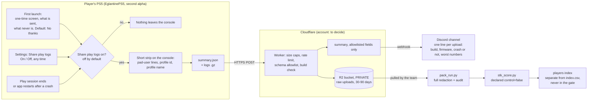

# Player logs for the second alpha: design (23 Nov 2026)

**Status:** proposal, discussed in Discussion #45. Nothing has been created or deployed: no Cloudflare
account, no Discord webhook, no emulator code. One local prototype of the Discord summary check (fake
data, no network); not in this repo yet.

**The ask:** collect logs from *other players* of the next Green Hat Boy alpha (EglantinePS5 running the
game on a PS5): logs to a private store on Cloudflare, a short summary on into Discord. Ready for the
second alpha, which ships after phase 4.

**Marking:** every claim is **[known]** (read in code, a log, or a repo on 23 Nov) or **[assumed]** (my
expectation, to be checked; most of these wait on Cloudflare's and Discord's current documentation).

**Amended 23 Nov, after review:** consent is asked **once**, on the first launch, not after every session
or crash. Off by default; the player can opt in there, and it becomes an on/off setting they can change
any time. While it is on, uploads go without further questions. (§0, the diagram, §3.3, §4.5, §6.)
Also: the second alpha ships **option B in full, summary and logs together**; no summary-only first step.

---

## 0. The answer in five lines

1. **The emulator can already do the network part.** The alpha has libcurl with the console's HTTPS and
   certificate list, and an HTTP helper that POSTs files as forms. On our console the alpha reaches GitHub
   over HTTPS at every launcher start (the update check). **[known]**
2. **Nobody in GHB has built log upload, telemetry, a crash uploader or a Discord pipeline.** Today the only
   way in is a GitHub issue form ("Send a run log"). It has had **zero** uses. One outside tester (issue #28,
   a PS5 Pro) attached logs by hand, and they were worth a whole finding. **[known]**
3. **Recommended: option B.** On first launch the emulator asks once whether the player wants to share
   play logs (off by default). If they opt in, it sends a small *summary* plus the *logs* after each
   session or crash, and the choice stays a setting they can turn off. They go to a Cloudflare Worker that checks them and stores the logs privately (R2).
   Only the summary reaches Discord, through an allowlist. We pull the logs and run the packer and the
   scorer on them as we do with our own runs.
4. **The packer stays the one redactor.** It is Python and can't run on the PS5, so the console only does
   a short strip (the two pad-user lines, the profile id, the profile name). The full redaction and audit
   run on our side before a player run goes anywhere shared.
5. **Open decisions:** who owns the Cloudflare account and the Discord webhook, which server and channel,
   who may read raw uploads, how long they're kept, and whether Vampinity takes the emulator patch into
   the second alpha.

---

## 1. Overlap search (the standing rule)

Searched on 23 Nov: the inventory ledger (grep, 3,846 rows); a fresh GreenHatBoy clone (main @ `01a38b3`,
22 Nov 17:41) and all nine branches; the open PRs #32, #34, #38 (Vampinity's runner) and #42; the issues;
the newest comments in Discussion #2; the emulator source (the fork and the alpha T186 tree).

| What exists | Where | Owner | State | Relevance |
|---|---|---|---|---|
| **"Send a run log" issue form** + "Crash or glitch" form | GHB `.github/ISSUE_TEMPLATE/run-log.yml`, `crash.yml`; README "Where to talk", CONTRIBUTING §1 | Vampinity | live since 12-13 Nov | The current channel. **0 run-log issues filed.** The form says files there are public and tells players to delete the two pad lines or run `tools/pack-run.py` |
| **Issue #28**: one outside tester's logs (PS5 Pro, 13.00) | GHB issue #28; our read of it (20 Nov) | outside tester; read by us | answered | Proof of value: showed the Pro has the same 12,352 MiB pool, a store grown in play, and two out-of-memory crashes at loads. One zip, 1.4 MB, no pad lines |
| **The log pool** `runs/` + `index.csv` | GHB | Vampinity (packer, index), layout ours | live, 1,347 rows | Where shared runs go. Player runs must **not** mix into it (§5) |
| **Redaction:** `tools/pack-run.py` (his) imported by our `stk/pack_run.py` (+ profile id either case, profile name, save name, audit that deletes and exits 2) | GHB `tools/`, our `stk/` | Vampinity + us | live | **Reuse; don't write a second one** (§2) |
| **The scorer** `stk_score.py` (scorer 10), reads crash copies | GHB `tools/stk/` | waveydude + our run-contract changes | live | Scores a player run unchanged; `control_eligible` comes out false when `declared.control` is false |
| **The crash handler** `headless/crash_report.cpp` | emulator (alpha has it) | upstream EglantinePS5 | live | Writes `logs/crash-YYYYMMDD-HHMMSS.txt` (+ `-eden_log.txt`, `-stderr.log`, `-heap.log`), restarts the app, and **the launcher is told where the report is**: the natural moment to offer "send this crash" |
| **HTTPS out of the app:** libcurl via `update_check/console_curl.c` (console name lookup, certificate list); `remote/http.c` does GET/POST/PUT, JSON bodies, **multipart file upload** | emulator `headless/update_check/`, `headless/remote/` (alpha has both) | upstream (PS5 Native App Boilerplate's kit; the RomM save-sync backend) | live | The transport exists. A new uploader is a caller of `remote_http`, not a new network stack |
| **The update check** pings `raw.githubusercontent.com/viejunerd/Eglantine-PS5-/catalog/` at every launcher start | `update_notice.cpp`, `frontend.cpp:234` | upstream | **live in the alpha**; our play logs show `update check: result=available installed=01.219.028 available=01.219.029` | Shows HTTPS works from the homebrew on a networked console. Also means the alpha already makes one outbound call per launch (not log data) |
| **QR codes in the launcher** (`pe/ui/qr_code.cpp`, used by pairing) | emulator | upstream | live | Can show a link to the privacy page or to a player's own report, no typing on the console |
| **Settings → Diagnostics** page and "Testing switches" (written to `/data/eglantineps5/config/env.txt`) | `pe/ui/settings.cpp`, `testing.cpp` | upstream | live | Where an "Send reports" toggle would sit |
| waveydude's W-03 removed "the online update probe" | private fork (W-03) | waveydude | his builds only | A precedent that a collaborator once took network calls *out*. Ask him why before adding one |
| Vampinity's runner (draft PR #38): `tests/offline_guard.py` makes every socket fail in tests | GHB `runner-draft` | Vampinity | draft | No upload; it reads crash reports from the console over his bench. Its crash classes (device lost, system error CE-108255-1) are worth reusing as `ended` values |
| Group Discord server (three of us) | linked from waveydude's PR #34 report | Vampinity proposed it (private fork issue 1) | live | A candidate home for the channel. To decide (§7) |

**Not found anywhere:** "telemetry", "webhook", "Cloudflare", "Worker", "consent", "opt-in" for logs, or
any upload of `eden_log.txt`, in GHB, its branches, the ledger or the emulator. **No one is working on
this.** Discussion #2's newest lines (20-22 Nov) are phase 4, R × C, the mic fix and Vampinity's night 1:
nothing overlapping.

---

## 2. What a player's run leaves on the console, and what's gold

### 2.1 The files **[known]**, sizes from our own runs

| File | Where on the console | A 6-min control start | A 50-min play that crashed (runPlay7) | gzip ratio |
|---|---|---|---|---|
| `eden_log.txt` | `/data/eglantineps5/user/log/` | 1.33 MB | 5.15 MB (`crash-*-eden_log.txt`) | ~10× |
| `stderr.log` | `/data/eglantineps5/logs/` | 0.83 MB | 6.01 MB | ~10× |
| `heap.log` | `logs/` | 0.20 MB | 1.18 MB | ~6× |
| `boot-trace.txt` | `logs/` | 1-1.4 KB | same | — |
| `crash-*.txt` (the report) | `logs/` | none | 2 KB | — |
| `crash-index.txt` | `logs/` | — | 22 B | — |
| `mkw-vma-<pid>-<n>.json` (Vulkan memory census) | `logs/` | only with the census switch | 222 KB each, 9 of them in a 2-min run | ~10× |
| `env.txt` | app folder | 7 KB | 9 KB | — |
| `config.json` (the app's settings) | `config/` | small | small | — |
| Sampler `.bin`, guest-memory dumps, thread dumps, flight/timeline `.bin` | `logs/` | **only with log-only switches**, not in a player's env | — | — |

**One upload, compressed: ~0.25 MB for a short start, ~1.3 MB for a long play that crashed.** **[known]**
for our runs; a player's could be larger after hours of play. **[assumed]** Cap at 8 MB compressed.

**`logs/` keeps every earlier session's crash files** (our old runs held 5 crash reports each, not
necessarily the run's own). **[known]** The uploader must send the *newest* session's files only, matched
by time, the way scorer 10 already matches crash copies to a run.

**After a crash the app restarts,** so `eden_log.txt` and `stderr.log` are the *relaunch's*; the crash's
own are the `crash-*-` copies. **[known]** (TECHNICAL.md, 22 Nov.)

### 2.2 The gold

What the scorer reads, ranked by what other players can tell us that our three consoles can't:

| Gold | Lines / file | Scorer field | Why from players |
|---|---|---|---|
| **Boot facts**: build, content version, firmware, console (base/Pro), mode, resolution, env hash, store state and size, translation id | `eden_log.txt` head, boot-trace, `EDEN_GBB_ENV`, stamp line | `build`, `firmware`, `mode_resolution`, `env_hash`, `shader_store`, `store_pipelines`, `cache_class` | **The spread we've never seen:** firmwares besides 9.40/12.40/13.60, Pros, docked, changed settings |
| **Crashes**: kind, thread, the memory left, time into the session, the stack (addresses only) | `crash-*.txt` | `crash_class`, `survival_result` | **Crashes per hour by build** across many players: the flashes-and-crashes programme's unit, which we can't fill from three consoles |
| **Memory lines**: largest free block, driver free block, stranded, census | `EDEN_MEM_CENSUS*`, `RADV_PS5_MEMORY available_mib`, heap.log | `largest_free_block_min_mib`, `largest_free_block_driver_min_mib`, `stranded_at_low_mib` | The memory wall in places our routes never go |
| **Refusals** (tries, and the distinct floor) | stderr `EDEN_GRAPHICS_MEMORY an image/a buffer was refused:` | `graphics_refusals` | How close to the wall real play runs |
| **fps windows** (5 s lines), worst frame, hitch ms/min | 5 s fps lines, frame lines | `fps_median`, `fps_mean`, `worst_frame_ms`, `hitch_ms_per_min` | Real-play fps by area, without a route; less exact but far more of it |
| **Shader builds in play** | stamp and pipeline lines | `shader_builds_in_play`, `left_to_prepare` | Issue #28 showed players grow their own store; how fast, on what |

**Not gold for players:** route proof, scoring windows, `wait_met`/STEER lines (they don't run scripts),
`control_eligible` (always false, §5).

---

## 3. Privacy

### 3.1 What in a log identifies a player **[known]** unless marked

| Item | Where | Handled by the packer today |
|---|---|---|
| Console user number (decimal and hex) | `EDEN_PAD_OPEN` / `EDEN_PAD_USERS` (2 lines per process); in old `klogs/` also elsewhere | Yes: pad lines dropped, the number learned and replaced everywhere |
| Save-profile id, 32 hex, **either case** | `user/save/<16 hex>/<32 hex>` paths | Yes (ours), either case, and learned by value |
| Launcher profile name (can be an account name) | `launch: Profile …` | Yes (ours) |
| Game file name as the player named it | crash report `running:` line, loader lines | **Partly**: other games' titles are removed; *this* game's file name is kept, and a player may have named it with personal words **[assumed risk]** |
| LAN addresses, MACs | RomM/NFS/FTP sources in `config.json`, `remote/` logs | Audited (refused if found); `config.json` redacted |
| Home paths, e-mails | not on a PS5; only from a PC | Audited |
| The player's IP address | **not in the log**; the Worker sees it on every request | New: see 3.3 |
| Playtime, times of day | log timestamps | Not identifying alone; kept |
| Hardware ids | the 32-hex values in loader lines are the game's own build ids, not the console's **[known]** (read in a control log) | n/a |

### 3.2 Redact on the console, or at our end?

- **The packer is Python, 367 lines, plus Vampinity's `pack-run.py` it imports. It can't run on the PS5.**
  Porting it to C++ would be the second redactor we've agreed not to write.
- **So: two layers, one source of truth.**
  1. **On the console, a short strip** that only *drops or blanks*: the two pad lines (whole), any
     `user/save/<16>/<32 hex>` → `<profile>`, `launch: Profile …` → `<redacted>`, and only the newest
     session's files. Five rules, each a copy of a packer rule, and the packer's tests are run against the
     console's output to prove they agree. Purpose: the raw bucket never holds a user number or profile id.
  2. **At our end, `pack_run.py` with its audit** before anything leaves the private bucket, as for our
     own runs. If the audit refuses, the run stays private and the console's strip gets a fix.
- **The summary sent to Discord carries none of the above by construction:** it is not derived from log
  text by the Worker, it is a fixed set of typed fields, and the Worker drops anything else
  (the summary prototype, §8).

### 3.3 Consent, retention, readers (proposal; open decisions in §7)

- **Asked once, then a setting.** The first time a player opens a build with this feature (a new player,
  or someone updating to the second alpha), one screen asks whether to share play logs. **Off by
  default:** the highlighted button is "No thanks", and closing the screen counts as no. The answer is
  saved as a setting, **Settings → Share play logs: On / Off**, which the player can change at any time.
  While it is on, the emulator sends after each session or crash **without asking again**; while it is
  off, nothing leaves the console. The screen is never shown again on its own.
- **Asked again only if what is sent grows.** The second alpha sends the summary and the logs from the
  start. If a later build ever adds something to that list, the first-launch screen is shown once more
  with the new list, and the setting stays off until the player says yes to it. A yes to less is never
  read as a yes to more.
- **What the player sees** (draft for the first-launch screen, plain words, one screen):
  > *Help make the emulator better?* If you turn this on, after each play session or crash the emulator
  > sends the Green Hat Boy team its logs and a short summary. It helps us fix crashes and slowdowns.
  > **Sent:** the emulator's logs from that session and a short summary (build, firmware, fps, memory, crash or not).
  > **Never sent:** your saves, your game files, your PSN name, your console's user number.
  > **Who sees it:** the summary appears in the team's Discord channel without your name. The logs are read only by the three of us and deleted after 30 days.
  > You can turn this off at any time in Settings → Share play logs. [No thanks] [Share play logs]
  >
  > A QR code links to the privacy page.
- **The setting's page** shows the same list, the on/off switch, the time of the last upload, and the
  player's **report code**.
- **The report code** is random, made on the console when the player opts in, not tied to the console or
  account. It is sent with each upload and is the only handle for a deletion request ("delete everything
  for K7Q-4MX"). Turning the setting off and on again makes a new code.
- **The IP address** is used by the Worker for rate limiting only, in memory, and **never stored** in R2
  or logged. **[assumed]** Cloudflare itself logs requests for its own operation; the privacy page says so.
- **Retention:** raw uploads in R2 30 days by default (an R2 lifecycle rule deletes them); packed and
  audited runs kept as long as the project needs; Discord lines are kept (they hold nothing identifying).
- **Readers:** raw R2: only the account owner and whoever they give a read token. Packed runs: the three
  of us. Public: the Discord line, and only those packed runs the team chooses to publish after the audit.
- **Nothing that identifies a player reaches a public channel:** the Discord line has typed fields only;
  raw logs never go to Discord or GitHub; packed runs go public only through the audited packer.
- **[assumed]** Players in the EU make GDPR apply in spirit at least: opt-in, a stated purpose, a
  retention limit and a way to delete are the minimum, and the design has all four.

---

## 4. Transport

### 4.1 The shape: known vs assumed

| | |
|---|---|
| **[known]** | The console can make the HTTPS call (§4.2) |
| **[assumed]** | A Cloudflare Worker receives a POST and stores to R2 (or KV for small items); a Discord webhook posts the summary; some anti-abuse (key or rate limit, §4.3). To check against Cloudflare's and Discord's current documentation before building |

### 4.2 Can the homebrew upload? **[known]**

- libcurl with the console's name lookup, certificate list and non-blocking sockets (`console_curl.c`);
  `remote_http` does POST with a JSON body or a multipart file, with timeouts and a stop callback.
- The alpha calls the HTTPS update check at every launcher start, and our play logs show it answered.
- **[assumed]** Players without network, or with the PS5 kept offline to stay on an old firmware, are
  common in homebrew. The uploader must queue and fail quietly, and never retry in a loop.
- **[assumed]** Upload runs from the **launcher**, never during play: no network thread competing with the
  game for CPU or memory, which matters at our memory wall.

### 4.3 Abuse and spam

The upload key in a homebrew build is **public** the moment the build is (anyone can read the eboot), so
it is a label, not a secret. Defences that work anyway:

1. **Size caps** at the Worker: summary ≤ 4 KiB, logs ≤ 8 MB compressed; reject anything else.
2. **Schema allowlist** for the summary (typed, ranged; unknown fields dropped). Free text is never
   accepted, so nobody can post words, links or pings into the channel through us.
3. **Build allowlist:** `content_version` must be a released alpha's.
4. **Rate limits:** per IP (e.g. 5 uploads an hour) and global (e.g. 500 a day). Cloudflare's rate-limiting
   binding or a counter in KV/Durable Objects. **[assumed]** feature names and limits; check the docs.
5. **Discord is fed from a queue,** at most a few lines a minute, so a flood can't get the webhook banned.
6. **Logs land in a quarantine prefix** and are only read with our tools, never opened in a browser or
   rendered; they're gzip text.
7. **A kill switch:** one Worker variable that turns uploads into 410 Gone; the emulator stops offering
   when it sees 410.

### 4.4 Cost **[assumed]** (public pricing as I know it; recheck before deciding)

| | Free tier | Our likely use (100 players × 3 uploads a week × ~1 MB) |
|---|---|---|
| Workers | 100k requests/day | ~50/day |
| R2 storage | 10 GB-month free, then ~$0.015/GB | ~1.2 GB a month at 30-day retention |
| R2 operations | 1M writes, 10M reads a month | ~1,300 writes |
| R2 egress | free | — |
| Discord webhook | free; ~30 messages/min per webhook | ~50/day |

**Expected cost: $0**, inside the free tiers, unless the alpha gets far more players than we expect. A
Cloudflare account still needs an e-mail and is tied to whoever makes it.

### 4.5 The options

| | **A. Better manual path** | **B. Console upload: Worker + R2 + Discord (recommended)** | **C. Summary only (telemetry ping)** |
|---|---|---|---|
| What | No emulator change. A "Send logs" page: player copies `logs/` by FTP, drops the folder on a web page (or runs `pack-run.py`); or the existing issue form, rewritten | Section 0's diagram | The emulator sends only `summary.json` (≤ 4 KiB). No logs |
| Emulator work | none | an uploader (caller of `remote_http`), the short strip, the consent screen, a switch | a smaller uploader, consent screen, switch |
| What we get | Full logs, rarely. The form has had **0** uses in 10 days | Full logs **and** a summary, from everyone who says yes | Crash rates, fps, memory, firmware spread; **no** stacks, no lines to dig in |
| Privacy | Player does the redaction (error-prone: issue #28 was clean, the 16 Nov packs of our own weren't) | Strip on console + audited packer at our end; raw bucket private with a 30-day limit | Smallest: no log text leaves |
| Accounts | GitHub only (exists) | Cloudflare + Discord webhook | same as B |
| Ready by alpha 2 | yes | yes, if Vampinity takes the patch | yes |
| Risk | Little data | A patch in a release build; the bucket must be run carefully | Little to dig into when something is wrong |

**Recommendation: B, in full, in the second alpha: the summary and the logs together.** C stays only as a
fallback if the logs part isn't ready in time (it is the same uploader without the log files); it is not
the plan. Keep
A's issue form as the public route for players who'd rather not use the uploader, and point its text at
the packer.

---

## 5. How player runs feed our tools, and what they can't be compared with

**The flow:** pull from R2 (a small script with a read-only token) → `runs-players/<code>/` locally →
`pack_run.py` (redaction + audit) → `stk_score.py` with a synthesized `declared.json`
(`{"control": false, "source": "player", "report_code": "…"}`) → a **separate** index.

- **[known]** `control_eligible = declared.control and window_comparable and start_ok and end_ok`: false for
  every player run, by the declared flag alone. The gate's code never sees them.
- **[known]** The scorer already reads crash copies (scorer 10), raw or packed folders, `.gz` or not, and
  derives firmware, build, store and mode from the logs. **No scorer change is needed** for a first pass.
- **A separate index, `index-players.csv`**, never rows in `index.csv`. That keeps `index.csv` the
  measured record and keeps player rows out of every floor.

**What player runs can't do:**

- **They are not control starts:** unknown settings (the env hash shows whether they're stock), unknown
  store and cache state, no route, no fixed stops, played wherever the player went. They never enter the
  gate, the floors or an A/B (`abcompare` needs 4 controlled runs a side).
- **They are self-selected:** players who crash are likelier to send. Rates from them are upper bounds,
  not estimates.
- **What they're good for:** the *spread* (firmwares, Pros, docked, store sizes, settings changes); **crash
  rates per hour of play by build and by kind** (the crashes programme's unit); **where** in the game the
  memory wall bites (refusals and free block around loads); bugs we'd never reproduce on three consoles.
- **Compare like with like only:** player runs against player runs, the same build and firmware and
  stock env, never against a control floor.

---

## 6. What it needs in the emulator, and who owns it

| Piece | Where | Size [assumed] |
|---|---|---|
| **The setting** "Share play logs", off by default, saved with the launcher's other settings [assumed: the same store Settings already writes], plus the consent version the player said yes to. A build constant compiles the whole feature in or out, and the endpoint URL is a build constant too, not an env line, so a modified env can't redirect uploads elsewhere | launcher settings | small |
| **First-launch screen** in the launcher: shown once, on the first launch of a build with the feature, and again only when what is sent grows (a higher consent version). "No thanks" highlighted; a QR to the privacy page | `pe/ui/`, next to the update dialog | medium (the UI work is most of it) |
| **Settings row** "Share play logs: On / Off", with the list of what is sent, the last upload time and the report code | `pe/ui/settings.cpp` | small |
| **Collector**: pick the newest session's files, strip (5 rules), gzip, write `summary.json` from values the emulator already logs | new `headless/player_report.cpp` | medium |
| **Uploader**: at the next launcher start after a session or a crash restart (the launcher already knows the crash report's path), and only if the setting is on: one POST via `remote_http` (multipart: summary + logs), from the launcher thread, with a timeout, never during play; a 410 from the Worker turns uploads off for that build | same file | small |
| **Tests** on the host: the strip agrees with `pack_run.py` on our own logs; the summary passes `summary.py`'s checks | `tools/` | small |

**Owner:** the release builds are **Vampinity's**, so nothing ships unless he takes it into the second
alpha. Proposal: we (GrowingBlackBeans) write the patch in the shared numbering,
behind the switch, with its host tests; he reviews and decides whether it goes in. waveydude's view is
worth asking for first, since he removed a network call (W-03) once. The Worker and the summary checks
are ours to write; the account and webhook are whoever we decide (§7). The upstream maintainer
(viejunerd) owns the update check and the HTTP helper we'd call; no change to them is needed.

---

## 7. Open decisions

1. **Go or no-go**, and which option. **Decided 23 Nov: B in full (summary and logs) in the second alpha**,
   asked once on first launch, then a setting (§3.3).
2. **The Cloudflare account:** who creates and owns it (one of us, or a project account), and who holds
   its tokens.
3. **Discord:** which server (the three-person group or a new public one), which
   channel, and who owns the webhook. (Nobody has made one.)
4. **Readers of raw uploads:** one person, the three of us, or anyone else.
5. **Retention** of raw uploads (30 days proposed).
6. **Who reviews:** the patch (Vampinity, as release owner), the consent wording (all three?), the privacy
   page.
7. **Raised with Vampinity and waveydude** on 23 Nov (Discussion #45, and a line in #2).
8. **Timing:** build it during phase 4 (desk work, no console) or after; it must not take console time from
   batches A and B.

---

## 8. Not done

No Worker code (waits on the account decision), no emulator code. The summary prototype (an allowlist
validator for the Discord line, with a self-test showing free text, ids, links and `@everyone` can't get
through) can go in `tools/GrowingBlackBeans/` if it's useful.
