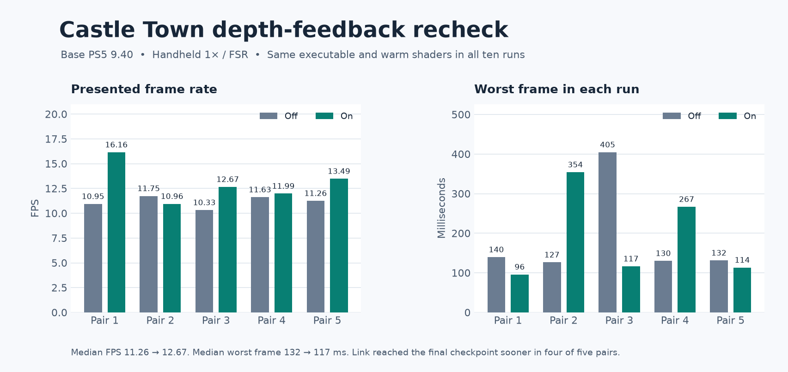
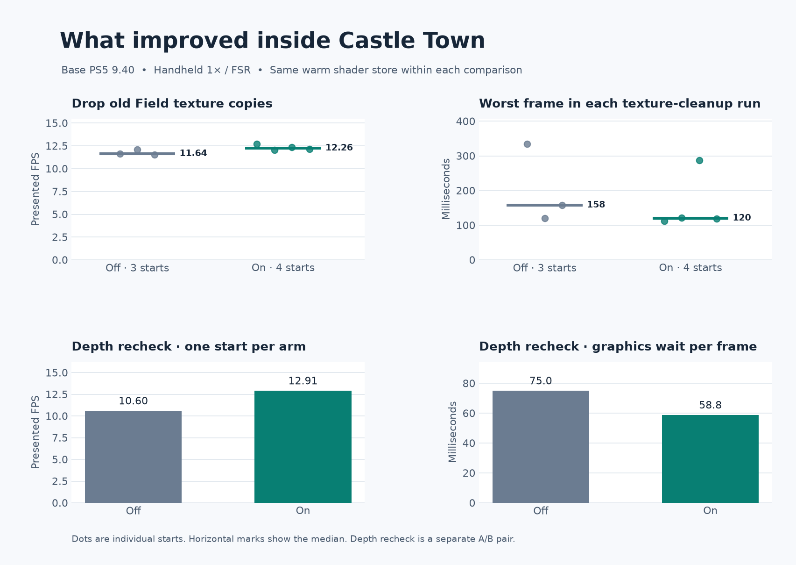
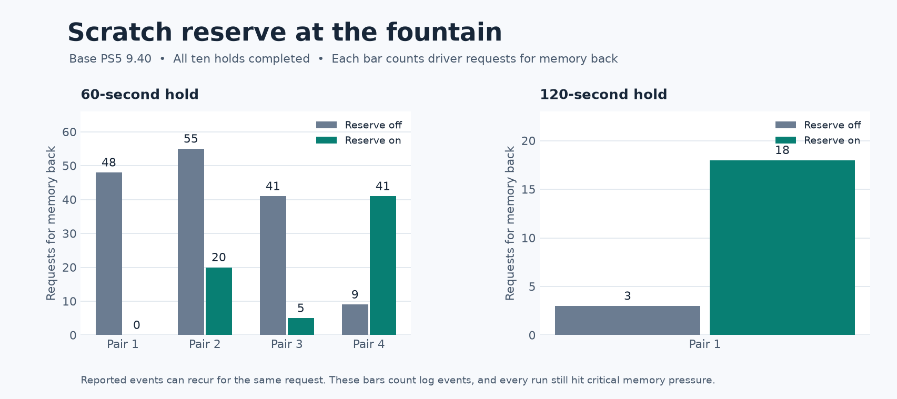
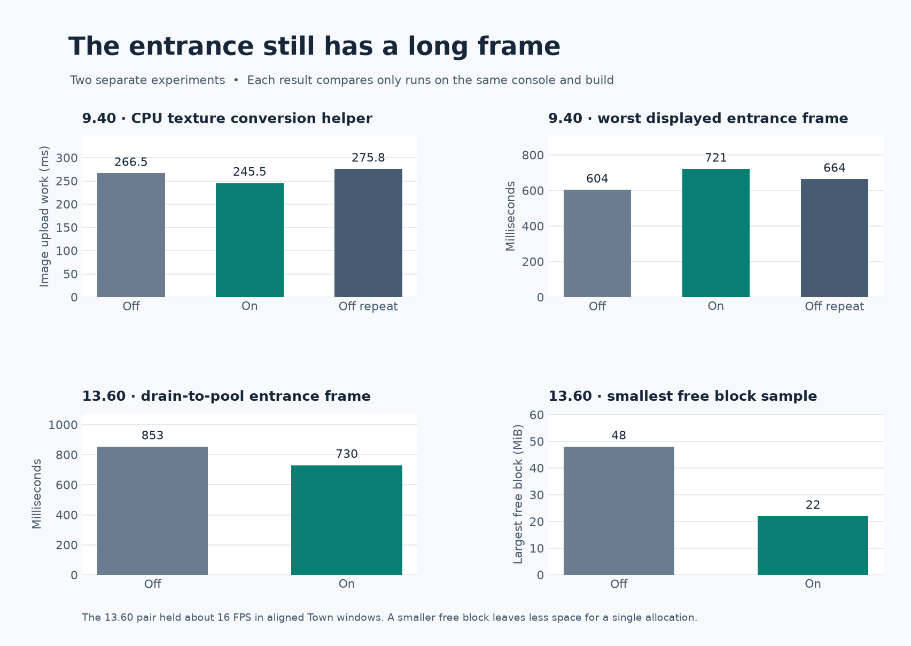

# Castle Town performance report-back

**November 21, 2026 · waveydude · base PS5 9.40 and 13.60**

The depth-feedback fix took median Castle Town FPS from **11.26 to 12.67 (+12.5%)** across five matched pairs on 9.40. The median worst frame dropped from **132 to 117 ms**. Link reached the final street checkpoint sooner in four of five pairs. The big entrance hitch and a sustained 15 FPS are still open.

## Five matched depth-feedback pairs on 9.40

| Pair | FPS off → on | Worst frame off → on | Mean fence wait off → on | Banner to final checkpoint off → on |
|---|---:|---:|---:|---:|
| 1 | 10.95 → 16.16 | 139.8 → 96.2 ms | 74.2 → 45.0 ms | 16.89 → 12.31 s |
| 2 | 11.75 → 10.96 | 126.7 → 354.4 ms | 66.3 → 73.1 ms | 16.29 → 16.82 s |
| 3 | 10.33 → 12.67 | 404.8 → 116.7 ms | 80.1 → 61.7 ms | 16.89 → 15.26 s |
| 4 | 11.63 → 11.99 | 130.4 → 267.1 ms | 66.6 → 65.0 ms | 16.34 → 15.85 s |
| 5 | 11.26 → 13.49 | 131.5 → 113.6 ms | 70.7 → 56.8 ms | 16.94 → 13.85 s |

All ten runs used the same executable, starting save and route with handheld 1×, AMD FSR and all 81,025 warm pipelines from `prep_8ba969cb`. Only `EDEN_UP_DEPTH_FEEDBACK_RECHECK` changed. The score uses full five-second presentation windows inside +19 to +35 seconds of the Town archive request. Scoring the same number of nearby windows gave three improvements, one near tie and one small drop. The faster run reaches the final corner sooner, so the original score can include more time standing still. Sampled footage confirms faster movement updates in the stronger run and shows no obvious visual regression. Full rendering coverage remains open. [All ten runs and build identities](depth-recheck-five-pairs.csv)

The fix checks whether the current draw reads the active depth image. Draws with a real overlap still get the required barrier. The previous optimization could reuse a decision across draws that bind different views. A separate 9.40 diagnostic pair matched each measured long wait to its exact emulated fence signal. The median time before the signal fell by **10.16 ms** with the fix on. Once the signal arrived, the game resumed in about **0.015 ms** in both arms. The median delay from recording a sampled submission to the Vulkan worker picking it up was about **0.036 ms**. Those timings put the bottleneck before the signal, with little time spent waking the game or handing commands to Vulkan.

| 9.40 synchronization diagnostic | Depth fix off | Depth fix on |
|---|---:|---:|
| Median time until the matching signal | 83.42 ms | 73.26 ms |
| Median frame interval in the presentation loop | 100.68 ms | 88.46 ms |
| 95th-percentile frame interval | 135.85 ms | 124.78 ms |
| Frames over 100 ms | 76 of 147 | 50 of 164 |
| Frames over 250 ms | 2 of 147 | 3 of 164 |
| Worst frame interval | 427.82 ms | 598.43 ms |

The longest ON frame coincided with a single 0.2 MiB texture upload that took **498.7 ms**. The longest OFF frame overlapped a **310.0 ms** allocation for a 2 MiB staging buffer used for an upload. The depth check addresses recurring rendering work. These examples show why a better typical frame can coexist with a long hitch. The diagnostics cover +19 to +35 seconds after the archive marker. The ON trace buffer filled after +35.53 seconds and dropped 778 later records. Diagnostic and uninstrumented FPS are measured separately.

### The same rendering work on 13.60

| Depth recheck | Town FPS | Worst frame | Timed GPU work per frame | Main 1080p target per frame | Timed pass segments on that target per frame |
|---|---:|---:|---:|---:|---:|
| Off | 12.58 | 132.0 ms | 43.13 ms | 29.66 ms | 500.5 |
| On | 13.37 | 113.7 ms | 22.13 ms | 8.19 ms | 173.6 |
| Off repeat | 12.84 | 110.5 ms | 43.48 ms | 29.53 ms | 487.2 |
| On repeat | 14.36 | 102.5 ms | 21.89 ms | 8.46 ms | 192.2 |

The main draw count stayed between about 1,540 and 1,620 per frame. Compute stayed near **6 ms**. The main target spent about **30 ms per frame** with the fix off and **8 ms** with it on in both comparisons. GPU time can overlap CPU work, and FPS increased by **0.79** and **1.52** in the two pairs.

With detailed pass timing off, a same-build 13.60 comparison went **12.57 → 14.40 FPS** and **62.2 → 53.1 ms** mean fence wait. The worst frame was similar at **115.2 → 116.1 ms**. Lightweight GPU counters put sampled busy time at **51.4% → 31.4%** in Town using approximately aligned intervals. That confirms a rendering-work reduction with the detailed probe off. This lighter comparison has one run per arm. The exact run identifiers and settings are preserved in the local evidence.

At the 9.40 enabled median of 12.67 FPS, a frame averages about **79 ms**. Holding 15 FPS takes about **67 ms**, 20 FPS takes **50 ms**, and 30 FPS takes **33 ms**. Relative to the measured baseline, those mean saving roughly **12, 29, or 46 ms** on the work that actually delays presentation. The 13.60 GPU measurements describe one part of that work and are kept separate from the 9.40 FPS benchmark.

### A shorter wait for command reads on 9.40

Some reads wait for the command recorder to drain all queued work. Lichii’s #1028 option waits for queued commands that may write the memory being read and still uses the full read path when needed. A separate verifier checked about **8,900** eligible reads in one Town window against the original method and logged **zero mismatches**. I kept depth recheck enabled for both performance arms.

| Pair | Targeted wait off → on | Town FPS off → on | Worst frame off → on | Banner to final checkpoint off → on |
|---|---:|---:|---:|---:|
| 1, OFF first | 281.1 → 167.0 ms/s | 14.32 → 11.98 | 118.1 → 333.0 ms | 13.81 → 15.86 s |
| 2, ON first | 319.4 → 156.1 ms/s | 12.79 → 14.98 | 356.0 → 114.4 ms | 14.86 → 13.32 s |

The narrower path reduced measured time per miss from **0.255 to 0.168 ms** in pair 1 and from **0.312 to 0.134 ms** in pair 2. Matching the number of nearby FPS windows gave **13.67 off and 11.98 on** in pair 1. Pair 2 already used two windows in both arms. The targeted wait consistently fell. FPS, worst frame and checkpoint time reversed direction across pairs, leaving a repeatable gameplay gain unverified.

## What changed while walking inside Town

The empty-submit patch stopped sending work to the GPU when the command buffer was empty. With the same 9.40 executable, route and shaders, both enabled runs had higher FPS and shorter worst frames than either control run.

| Run order | Empty-submit patch | Presented FPS | Worst displayed frame |
|---:|---|---:|---:|
| 1 | Off | 11.35 | 152.0 ms |
| 2 | On | 11.98 | 120.1 ms |
| 3 | On | 12.21 | 117.1 ms |
| 4 | Off | 11.00 | 138.4 ms |

Median FPS went **11.18 → 12.10**, and the median of the worst displayed frame per run went **145.2 → 118.6 ms**. The installed executable SHA-256 was `298c090967e388b3ac3fb85c80777d14e9361561bf86815303a2feb008ae8899`. Each run reused all 81,025 prepared pipelines.

The Field-to-Town profile matched two old Field texture arrays that had stayed resident through the load and had gone untouched in the reference runs. The patch selected **117.07 MiB** of textures for eviction. Neither array reappeared before the end of the interior segment. Returning to the Field still needs a dedicated replay to verify rendering and measure the rebuild cost.

| 9.40 texture cleanup | Off | On |
|---|---:|---:|
| Completed starts included | 3 | 4 |
| Median Town FPS | 11.64 | 12.26 |
| Median of each run’s worst displayed frame | 158.0 ms | 120.4 ms |
| Median graphics fence wait per frame | 67.3 ms | 64.6 ms |
| Median allocation-refusal records in the post-burst sample | 5 | 3 |
| Median pre-load texture bytes still resident at the after sample | 125.6 MiB | 11.1 MiB |

One off attempt ended at the time budget and is excluded from these medians. One complete on run still hit **287.9 ms** inside Town. Each dot is a run. The median uses complete five-second presentation windows inside +19 to +35 seconds after the Town archive request. [Seven completed run rows](town-texture-runs.csv)

The **depth-feedback recheck** asks whether the current draw actually reads the active depth image before waiting. In a separate 9.40 pair with the extra profiler off, presented FPS went **10.60 → 12.91** and mean fence wait went **75.0 → 58.8 ms per frame**. The worst frame in those Town windows went **348.8 → 360.0 ms**. The off arm had two complete windows and the on arm had three. This is a same-executable result from one pair. [Depth rows and binary identity](depth-recheck.csv)

A later series on a different installed executable gave two different results. Both pairs used the same save, route, graphics settings, and prepared shader store.

| Current 9.40 build | Depth fix off | Depth fix on | Worst displayed frame off → on |
|---|---:|---:|---:|
| Pair 1 | 10.59 FPS | 10.69 FPS | 322.1 → 408.2 ms |
| Pair 2 | 11.03 FPS | 13.93 FPS | 342.1 → 115.4 ms |

In pair 2, the average graphics fence wait fell from **73.8 to 55.2 ms per frame**. The five matched pairs above use the original executable.

## Scratch buffers and memory pressure at the fountain

The experiment reserved four **2 MiB** scratch buffers before the Town burst. Later same-build comparisons logged **3 → 1** and **1 → 0** fresh allocations taking at least 100 ms in the targeted window. The entrance still had a long frame.

| 9.40 hold after reaching the fountain | Reserve off | Reserve on |
|---|---:|---:|
| One-minute pair 1 | 48 | 0 |
| One-minute pair 2 | 55 | 20 |
| One-minute pair 3 | 41 | 5 |
| One-minute pair 4 | 9 | 41 |
| Two-minute pair | 3 | 18 |

These counts are driver requests for memory back. Repeated lines can come from repeated attempts. Some requests returned zero MiB. The counts describe pressure and recovery activity. **All ten holds completed.** The recorded largest free block still reached critical levels in both arms. Across the two-minute holds, the reported minimum was **0 MiB in both**, rounded to whole MiB. The fourth one-minute pair and the two-minute pair both reversed the early count advantage. [All ten holds, route hashes and installed ELF hashes](fountain-runs.csv)

## What still happens at the gate

A single graphics frame about **11 seconds after the archive request** uploaded roughly **808 MiB of images plus 362 MiB of buffers**. In one traced comparison, the largest individual image upload in that frame was **32.2 MiB**. The later slow 2 MiB scratch allocations were a separate part of the load.

On **9.40**, enabling one CPU helper for large texture conversions reduced measured image upload work in the first big frame from **266.5 → 245.5 ms** at the same **807.7 MiB and 761 uploads**. The worst displayed entrance frame got longer, from **603.5 → 721.4 ms**. A return to the control recorded **664.1 ms** at the entrance and **275.8 ms** of image upload work. The helper reduced the timed upload work in that burst. The displayed freeze remained the bigger problem.

On **13.60**, both drain-to-pool arms reached the same Town scene and stopped inside the market gateway. Both had **161 presented frames** over closely aligned windows roughly +24 to +34 seconds after the archive request.

| 13.60 drain-to-pool | Off | On |
|---|---:|---:|
| Worst displayed frame in the early entrance window | 853.1 ms | 730.0 ms |
| FPS in the closely aligned Town windows | 16.05 | 16.01 |
| Worst frame in those Town windows | 70.8 ms | 73.9 ms |
| Smallest largest free block in the Town entry census | 48 MiB | 22 MiB |
| Graphics memory returned in Town load-hold drain reports | Unavailable | 733 MiB |

The 733 MiB sums five return reports during the hold. The 48 and 22 MiB figures are from the same area-linked `EDEN_MEM_CENSUS largest=` field. They measure the size of the biggest available single block. The shorter hitch and lower block minimum come from one pair. [Run-level entrance and control rows](entry-comparisons.csv)

## All eight ideas

| # | Idea | What the tests established |
|---|---|---|
| 1 | Use earlier traces to find what can go | A manually derived profile for the Field-to-Town transition improved the typical moving run. A general predictor remains open. |
| 2 | Reserve and reuse graphics memory | A small Town scratch reserve prevented some slow allocations. The fountain counts varied, and a general startup reserve remains unproven. |
| 3 | Protect essential work under pressure | The optional screenshot-drop path passed host checks. The live check encountered no eligible allocation failure. Trinity found four crash stacks in the test’s own screenshot read, supporting the failure mechanism. The guard still needs a hardware case that exercises it. |
| 4 | Evict old texture copies and rebuild later | The #1 experiment removed two copies totaling 117.07 MiB through the measured Town segment. The return trip and rebuild cost still need measurement. |
| 5 | Track allocations by area | Tracking last use around this entrance located cold Field textures. Automatic tagging and cleanup by area remain open. |
| 6 | Clean up during loading | Two early packing runs packed about 259–260 MiB in 558–621 ms. The largest free block stayed flat during packing. Refusal counts were 14 in the reference and 4 in both packing runs, with different starting headroom. A same-build one-switch comparison is the follow-up. |
| 7 | Reduce the cost of large render targets | The existing fast clear avoided a 288 MiB temporary upload at each of two measured loads. The 297 MiB resident depth image remained. Format and dimension changes still need their own test. |
| 8 | Measure where graphics memory goes | The traces separated old resident textures, the first upload burst, and later scratch stalls. A fully correlated allocation and GPU-completion lifetime trace remains open. |

Credit to Trinity for the symbolized screenshot stacks. [Discord report](https://discord.com/channels/915824204312629249/1571576822917898411/1573686511310733384)

## Reproduction details

- **9.40** used handheld 1×, AMD FSR, and the existing `prep_8ba969cb` store. Comparisons hold the build, route and settings fixed within each experiment. The eight one-minute and two two-minute measurements start at the verified fountain checkpoint. The hold uses the `EDEN_MEM_CENSUS` largest-block samples between checkpoint and script completion.
- **Earlier 13.60 entrance and fountain replays** used handheld 1×, Bilinear and 1080p/60 Hz. The drain-to-pool pair used the same installed ELF (`bdcf6431d5a6f15904ae9ffed7fdee937b4010c7d4cce867f210724ac70e99dc`) and the existing store with 81,002 prepared pipelines. Its corrected Town route hash is `5d6d9f1b91d536d65418582b63980079d0c4a2fbc914003306ef30f9b81ebc05`. The scored windows were +23.949 to +33.980 seconds off and +24.686 to +34.741 seconds on. The early entrance windows ended at +13.960 and +14.594 seconds. The scored windows were screenshot-free.
- **Later shared 13.60 Town replays** used handheld 1×, AMD FSR, 1080p/60 Hz, and the existing store with 81,002 prepared pipelines. This includes the depth feedback pairs and the recorder, uniform binding, unpack cache, and packing-order measurements in the updated HTML report. The launch log identifies the filter for each cohort.
- **Ledger labels.** Uniform binding trim is patch 0564 (`EDEN_UP_UBO_BIND_TRIM`). Recorder memory work is patch 1004 (`EDEN_UP_BACKX`). Exact empty-submit suppression is patch 0750 (`EDEN_UP_EXACT_EMPTY_SUBMITS`). The local depth recheck and screenshot guard switches are `EDEN_UP_DEPTH_FEEDBACK_RECHECK` and `EDEN_UP_SCREENSHOT_DROP_ON_OOM`. See the [patches and test scope](../../../patches/waveydude/README.md).
- Each chart uses the CSV beside it. Empty cells mean the metric was unavailable. Regenerate the PNGs with `uv run --with matplotlib python charts.py` from this folder. Run IDs are UTC. These are personal test-build results under the [shared measurement rules](../../MEASURING.md).

## Raw timing exports

- [Presentation windows from the matched tests and the 13.60 diagnostics](town-presentation-windows.csv)
- [Per-frame Town intervals from the 9.40 synchronization trace](town-frame-trace.csv)
- [The two narrower-wait comparisons and their raw counters](narrow-read-wait-windows.csv)
